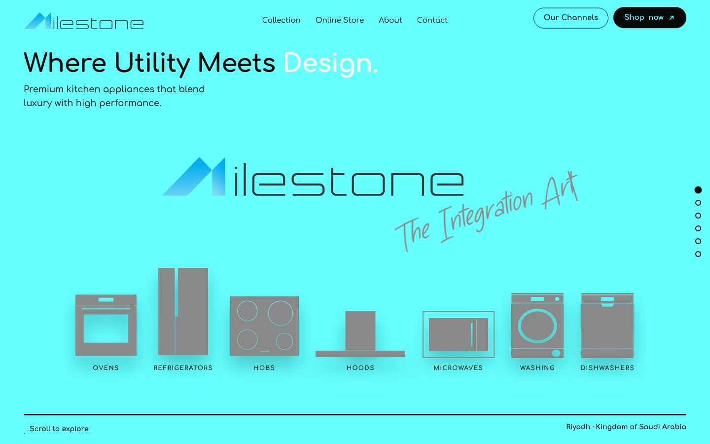
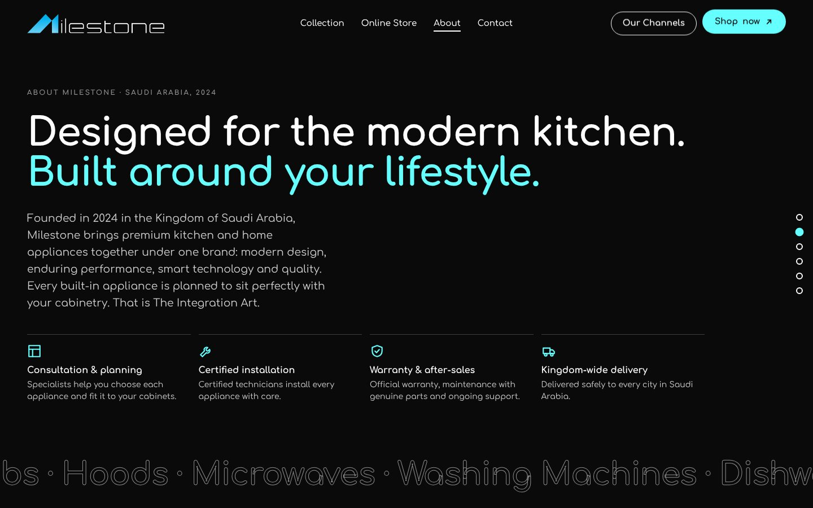
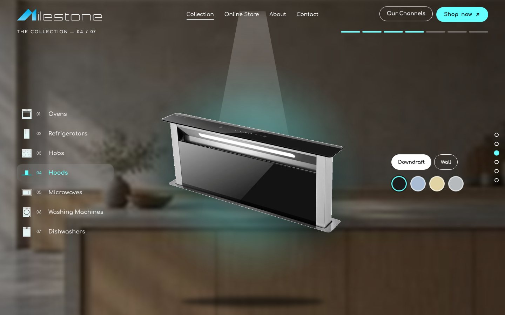
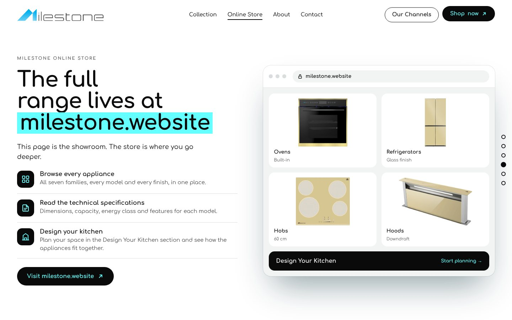
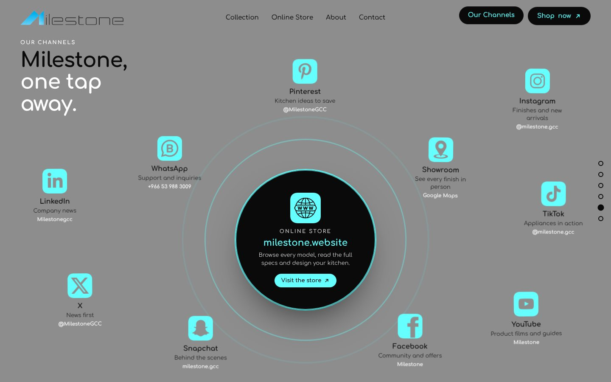
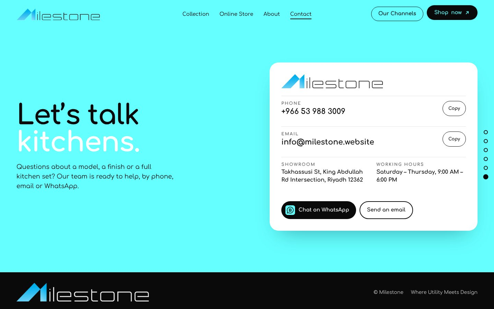
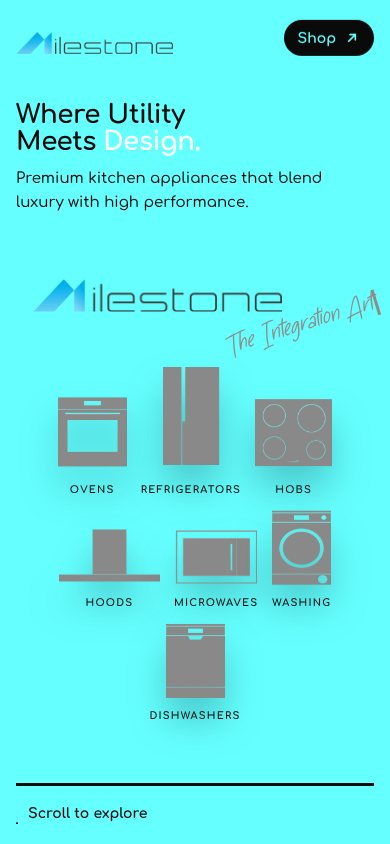
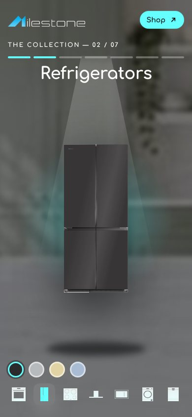
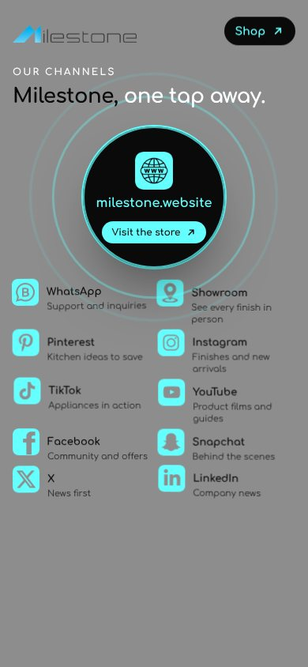

# Milestone — The Integration Art

**Live:** [milestonechannels.netlify.app](https://milestonechannels.netlify.app)

A single-screen showroom website for **Milestone (ميلستون)**, a Saudi brand of premium kitchen and home appliances founded in 2024 in Riyadh. The online store lives at [milestone.website](https://milestone.website); this site is the showroom that leads people to it.

The whole site is one screen. Scrolling, swiping or the arrow keys swap each scene in place, and every scene enters with its own transition.



## Scenes

| | |
|---|---|
| **Hero** — the Milestone logo draws in, *The Integration Art* is written letter by letter, and the seven appliance families drop in and float. |  |
| **About** — the brand story and the Milestone service: consultation, certified installation, warranty and kingdom-wide delivery. |  |
| **Collection** — each appliance under its own lighting over a kitchen backdrop. Pick a family, a model or size, and a finish. |  |
| **Online Store** — what visitors can do at milestone.website: browse every appliance, read the specifications and design their kitchen. |  |
| **Our Channels** — the store at the centre, with WhatsApp, the showroom and every social account floating around it. Opens with an explosion. |  |
| **Contact** — tap to call, email or chat on WhatsApp, with the showroom address and working hours. |  |

## On phones

<p>
  
  
  
</p>

## Interactions

- One-screen navigation driven by scroll, swipe, keyboard, the header links and the side dots
- A different transition for every scene: split, circle reveal, slide, explosion and curtain
- Collection: kitchen backdrop cross-fades, products rise into a spotlight, live finish and size switching
- Our Channels: icons swim around the store, react to the cursor and turn white on hover
- Header buttons float gently; the hero reacts to mouse movement
- Respects *reduced motion* settings

## Run it

Open `index.html` in a browser. The channel icons, category icons and the tagline font are embedded in the page, so it also works straight from disk.

## Stack

- HTML, CSS and JavaScript in one file
- [GSAP 3.12.5](https://gsap.com) with the Observer plugin, loaded from cdnjs
- Fonts: Comfortaa (Google Fonts) and Simple Nathalie for the tagline

## Deploy on Netlify

The site is static and needs no build. In Netlify choose **Add new site → Import an existing project**, pick this repository, leave the build command empty and keep the publish directory as `.` (already set in `netlify.toml`).

## SEO, AEO and GEO

| File | Purpose |
|---|---|
| `index.html` `<head>` | Title, description, canonical, Open Graph and X cards, JSON-LD (Organization, HomeGoodsStore with address and hours, WebSite, FAQPage) |
| `assets/meta/og-image.png` | Link preview image: the Milestone M on white. The preview text reads *Where Utility Meets Design* |
| `robots.txt` | Allows search engines and AI crawlers (GPTBot, ClaudeBot, PerplexityBot, Google-Extended and more) |
| `sitemap.xml` | Home page with product images |
| `llms.txt`, `llms-full.txt` | Brand facts, services, contact and FAQ for AI assistants and answer engines |
| `site.webmanifest`, `favicon.ico`, `favicon.png` | Icons from the grey Milestone M |
| `netlify.toml`, `404.html` | Caching and security headers, branded not-found page |

The canonical address is `https://milestonechannels.netlify.app`. If the site moves to another domain, update it in `index.html`, `robots.txt`, `sitemap.xml`, `llms.txt` and `llms-full.txt`.

## Project structure

```
index.html            the site
404.html              not-found page
netlify.toml          Netlify settings
robots.txt  sitemap.xml  llms.txt  llms-full.txt  site.webmanifest
favicon.ico  favicon.png
assets/
  meta/         share image and app icons
  brand/        logo variants
  icons/        appliance family icons
  icons-mask/   the same icons as masks for colouring
  products/     product photos by family, backgrounds removed
  kitchens/     kitchen backdrops for the collection
  channels/     store, WhatsApp, maps and social icons
  fonts/        tagline font
docs/screenshots/
```

## Links

- Online store: [milestone.website](https://milestone.website)
- Live site: [milestonechannels.netlify.app](https://milestonechannels.netlify.app)
- Instagram, TikTok and Snapchat: `@milestone.gcc` · X and Pinterest: `@MilestoneGCC`
